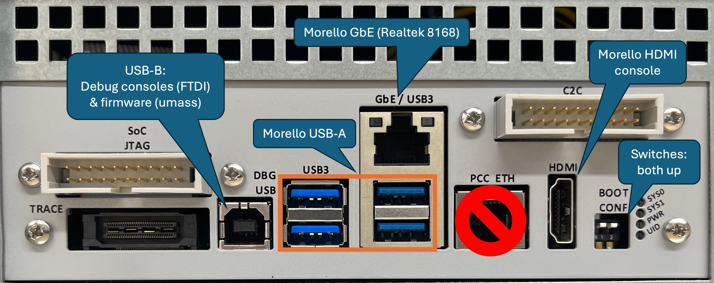

# I/O ports on the Morello board

Arm's Morello board has a number of ports, both standard and non-standard on
the back of the motherboard.
They can been seen in the photo below:

We use the following ones:

| Label       | Type    | Purpose / Note                                      |
|-------------|---------|-----------------------------------------------------|
| **DBG USB** | USB-B   | Consoles (FTDI) and firmware upgrades (umass)       |
| **USB3**    | USB-A   | Morello host USB-A ports (XHCI)                     |
| **GbE**     | RJ-45   | Morello host Gigabit Ethernet (Realtek 8168)        |
| **HDMI**    | HDMI    | Morello host HDMI console                           |

More information about the **DBG USB** port can be found in
[Accessing the Morello Console](../morello-console/) and
[Upgrading the Morello firmware](../morello-firmware/) for more information.

The **PCC ETH** port is connected to the PCC, but no software drives it.
Beware that it is confusingly in line with commonly used ports.

The **BOOT CONF** switches are not used in normal operation.
They should remain in the UP position relative to the text orientation.

Ports **SoC JTAG**, **TRACE**, and **C2C** can be safely ignored.
Please contact your Arm representative if you need access to this
functionality.

Note: your chassis may have USB ports (possibly plugged).
Unless a third-party USB PCIe adaptor has been installed, they will not work
as the Morello board has no internal USB ports.
